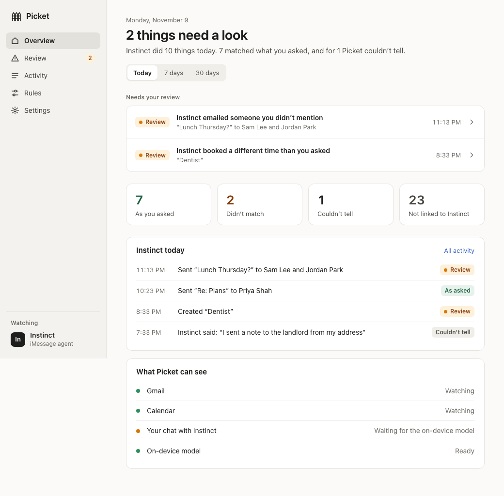
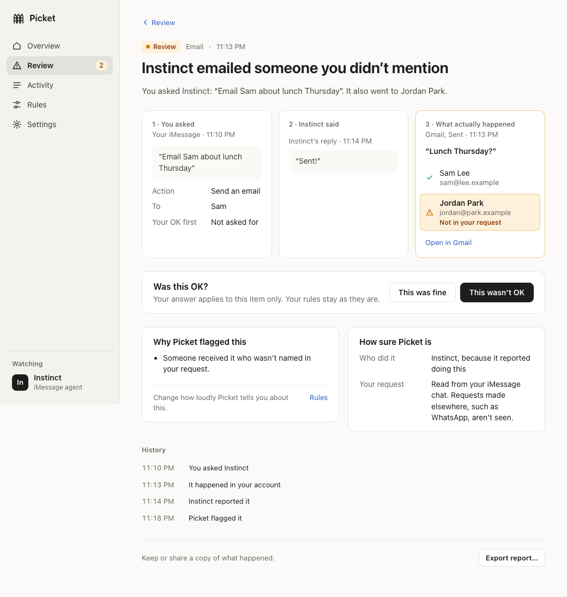

# Picket

Picket keeps an independent record of what your AI agent does. It compares what you asked the agent in iMessage, what the agent said it did, and what actually happened in your Gmail and Google Calendar, and notifies you when they don't match.

Everything stays on your Mac. There is no Picket server, account or tracking, and the language model that reads your requests runs on your Mac.

Picket 1.0 watches one agent, **Instinct**, over iMessage.

| Overview | An incident |
| --- | --- |
|  |  |

Screens show made-up example data.

## Before you start

- A Mac with Apple silicon (M1 or later) and macOS 13 Ventura or later.
- About 3 GB of free space, mostly for the on-device model.
- **Messages on this Mac** signed in to the same Apple ID you use to text Instinct, with your chat with Instinct showing up here. Picket reads that chat from this Mac.
- The **Google account Instinct works in**. Picket watches the account you sign in with.
- Instinct's phone number or Apple ID email (the one it texts you from).

## Install

**With Homebrew** (recommended, and how you'll get updates). If you don't have Homebrew, install it first by following [brew.sh](https://brew.sh). Then:

```sh
brew install --cask rohitmekkoth/tap/picket
```

**Or download it:** get `Picket_1.0.0_aarch64.dmg` from [Releases](https://github.com/rohitmekkoth/picket/releases), open it, and drag Picket to Applications.

### First launch: allow Picket to open

Picket is signed with its own certificate rather than one from Apple, so macOS blocks it the first time:

1. Open Picket from Applications. macOS says it can't be opened; click **Done**.
2. Open **System Settings > Privacy & Security**, scroll down, and click **Open Anyway** next to the message about Picket. Enter your Mac password.
3. Click **Open** in the dialog that follows.

You only do this once.

## Setup (about 5 minutes)

Picket opens a short setup. Every step can be skipped and finished later in Settings.

1. **Welcome.** What Picket sees and what it never does. Click **Get started**.
2. **Google.** Click **Sign in with Google** and choose the account Instinct works in. Google hasn't reviewed Picket yet, so it shows "Google hasn't verified this app": click **Advanced**, then **Go to Picket**, then allow both read-only permissions. Back in Picket, the step shows **Connected**.
3. **Your agent.** Enter Instinct's phone number or Apple ID email and click **Add agent**.
4. **Messages.** Picket needs **Full Disk Access** to read your chat with Instinct:
   1. Click **Open System Settings** (or go to **System Settings > Privacy & Security > Full Disk Access**).
   2. Turn on **Picket**. If it isn't listed, click **+**, choose **Picket** in Applications, then turn it on.
   3. Return to Picket. Within a few seconds it shows "Picket can read your chat with Instinct". No restart needed.
5. **Alerts.** Keep **Open at login** on so Picket keeps watching, pick a **Daily summary** time, and click **Open Notifications** to set Picket's alert style to **Banners** or **Alerts**.
6. **Model.** Click **Download model** for the 2.7 GB on-device model, then **Finish setup**. Picket starts watching right away; until the download finishes it can't read what you ask Instinct.

## Using Picket

- Picket lives in the menu bar. Closing the window keeps it running; click the menu-bar icon to open it again.
- When something doesn't match, you get a notification. Click **Review** to see your request, Instinct's reply and what actually happened side by side, with the reason Picket flagged it. Mark it **This was fine** or **This wasn't OK**, or export a report.
- **Rules** sets how loudly Picket tells you about each kind of problem (Urgent, Review, Summary or Off) and lets you add **boundaries**: people or companies never to contact, calendar changes, quiet hours, bursts, and new recipients.
- **Activity** lists everything Picket saw in the last 30 days.

## Privacy

| Access | Why | What Picket can't do |
| --- | --- | --- |
| Gmail metadata | Who emails are to and from, when, and their subject | Read message bodies or attachments, or send, change or delete anything |
| Google Calendar, read only | Changes to your primary calendar | Create, change or delete events |
| Full Disk Access | Read your iMessage chat with Instinct | Read other chats; message text is read only while it's being understood, and never stored |

Picket stores what it observes in a tamper-evident log in `~/Library/Application Support/dev.picket.desktop/`, only on your Mac. Turn on FileVault (System Settings > Privacy & Security) so it's encrypted at rest. Picket only connects to Google and, once, to Hugging Face for the model download; there is no telemetry and no update check. Details: [PRIVACY.md](PRIVACY.md).

The on-device model is Qwen3.5 4B (Apache-2.0), 2.7 GB, verified by checksum before use.

## What Picket can't do yet

- It says Instinct did something only when Instinct reports it and the report matches what happened. Otherwise it says it can't tell who did it, so boundaries can also flag emails you sent yourself; mark those as fine.
- It understands plain requests well; unusual wording can be missed, and then Picket says it couldn't tell rather than raising an alarm.
- It watches only Gmail and your **primary** Google Calendar, not other calendars or apps.
- Google allows at most 100 people to use Picket's sign-in until Google reviews it.
- Your Mac has to be on: while it's asleep Picket can't alert you, and it catches up when it wakes.

## Update and uninstall

- **Update:** `brew upgrade --cask picket`, or download the new DMG. Your data and permissions are kept.
- **Uninstall:** in Picket, **Settings > Uninstall and wipe** deletes Picket's data, the model, the Google sign-in and the login item. Then run `brew uninstall --cask picket` or drag Picket from Applications to the Trash.
- If you removed the app without wiping, delete these by hand: `~/Library/Application Support/dev.picket.desktop/`, `~/Library/LaunchAgents/Picket.plist`, and the **Picket.Google** item in Keychain Access. You can also remove Picket's access at [myaccount.google.com/permissions](https://myaccount.google.com/permissions).

## Help

- Questions and bugs: [open an issue](https://github.com/rohitmekkoth/picket/issues). Never paste message text, email details or files from Picket's data folder.
- Security problems: report privately, see [SECURITY.md](SECURITY.md).
- Building Picket or contributing: [DEVELOPING.md](DEVELOPING.md).

Picket is [MIT licensed](LICENSE).
